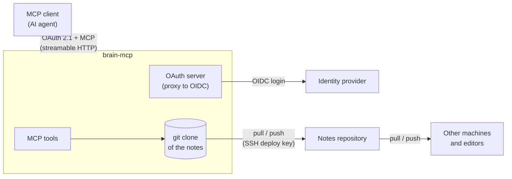

# brain-mcp

A remote [MCP](https://modelcontextprotocol.io) server that gives an AI agent read and write
access to a "second brain": a folder of Markdown notes linked with `[[wiki-links]]`
(Obsidian-style), versioned in a git repository.

The same repository stays shared with the other places the notes are edited (PCs, coding agents,
an Obsidian vault): the server works on its own clone, pulls before it reads and commits and pushes
every change right away. Notes can then be read and maintained from any MCP client, including
mobile ones.

## What it looks like

| Request | What the agent does |
|---------|---------------------|
| "What's left to do on the website project?" | `read_note("website")`, follows the links it needs |
| "Where did I write how the backups work?" | `search("backup")` |
| "Note that we chose Postgres, and why" | `edit_note` on the project note: one passage replaced, committed and pushed |
| "Rename the note `setup-pi` to `raspberry-pi`" | `move_note`: the file is renamed and every `[[setup-pi]]` link is rewritten, in one commit |
| "Delete the draft" | `delete_note`, then reports the notes that still link to it |

## Tools

- **Read**: `list` (notes, optionally under a directory), `search` (case-insensitive, in contents
  and file names), `read_note` (by relative path or by note name, as in a `[[wiki-link]]`).
- **Write**: `write_note` (create or replace), `edit_note` (replace one exact passage),
  `move_note` (move or rename, rewriting links), `delete_note`.

Every tool carries MCP annotations (read-only or destructive), so clients can ask for confirmation
before destructive calls.

## Architecture



- The server is its own OAuth authorization server for MCP clients (dynamic client registration,
  same origin as the MCP endpoint, as the MCP spec requires) and delegates the actual login to any
  OpenID Connect provider. Only one account (`ALLOWED_USERNAME`) may use the tools.
- The notes repository is reached over SSH with a deploy key restricted to that repository.

Code layout (`src/brain_mcp/`):

| Module | Role |
|--------|------|
| `vault.py` | File and git operations on the clone: path checks, note name resolution, search, link rewriting, pull / commit / push |
| `server.py` | MCP tools, their descriptions and annotations, auth and configuration |

## Design notes

- **Git is the sync and the safety net.** Reads pull at most every 30 s, writes always pull first,
  then commit `sync: <host> <date>` and push. If the push is rejected because another machine
  pushed in between, the commit is rebased and pushed again; on a real conflict the change is
  dropped, the clone is reset to the remote and the agent is told to read the note again. Any
  write, move or deletion can be reverted from the history.
- **Edits, not rewrites.** `edit_note` replaces one passage that must appear exactly once, which
  costs far fewer tokens than resending a whole note and cannot silently overwrite the rest of it.
- **No broken links.** A rename rewrites every `[[link]]` to the note in the same commit, and is
  refused when the new name is already used elsewhere (links would become ambiguous). A deletion
  reports the notes that still link to the deleted one.
- **Note names, as in links.** `read_note`, `edit_note`, `move_note` and `delete_note` accept a
  bare note name (`[[name]]`, `name|alias` and `name#heading` forms included) and resolve it
  anywhere in the vault, refusing ambiguous names.
- **Narrow file access.** Paths are confined to the vault, hidden directories (`.git/`, `.obsidian/`,
  any dot-folder holding tool configuration) are neither readable nor writable, and only `.md`
  files can be written, moved or deleted.
- **An optional index note.** With `INDEX_NOTE`, the index can be neither deleted nor moved, every
  tool description asks the model to read it first, and creating a note reminds the agent to list
  it there. Some MCP clients pass tool descriptions to the model but not the server instructions,
  so this one line is repeated in every tool; the deployment's own conventions
  (`BRAIN_INSTRUCTIONS`) only go into the server instructions, to keep tool descriptions short.

## Configuration

Environment variables (see `.env.example`):

| Variable | Required | Description |
|----------|----------|-------------|
| `BASE_URL` | yes | Public HTTPS URL of the server; the MCP endpoint is `$BASE_URL/mcp` |
| `BRAIN_REPO` | yes | Notes repository, cloned on first start (SSH URL, used with `./deploy_key`) |
| `OIDC_CONFIG_URL` | yes | OpenID configuration URL of the identity provider |
| `OIDC_CLIENT_ID`, `OIDC_CLIENT_SECRET` | yes | OIDC client registered for this server |
| `ALLOWED_USERNAME` | yes | The only account allowed (`preferred_username` claim) |
| `JWT_SIGNING_KEY` | yes | Signs issued tokens and encrypts the OAuth state (`openssl rand -base64 36`) |
| `GIT_AUTHOR_NAME`, `GIT_AUTHOR_EMAIL`, `GIT_COMMITTER_NAME`, `GIT_COMMITTER_EMAIL` | yes | Identity of the commits |
| `ALLOWED_REDIRECT_URIS` | no | Comma-separated redirect URI patterns MCP clients may register; empty: any client |
| `SYNC_HOST_LABEL` | no | Name in the commit messages (default `brain-mcp`) |
| `INDEX_NOTE` | no | Index note (e.g. `_index.md`), protected and pointed to by every tool |
| `BRAIN_INSTRUCTIONS` | no | Your own conventions (language, folder layout…), appended to the server instructions |
| `TZ` | no | Time zone of the commit dates |
| `PORT` | no | Listening port (default `8000`) |

## Deployment

Prerequisites: Docker with Compose, a git repository holding the notes (e.g. on GitHub), an HTTPS
reverse proxy, and an OpenID Connect provider.

1. **Deploy key**: next to `docker-compose.yml`, create a key and give it write access to the
   notes repository (on GitHub: repository settings → Deploy keys, "Allow write access"):

   ```bash
   ssh-keygen -t ed25519 -f deploy_key -N "" -C brain-mcp
   sudo chown 1000:1000 deploy_key && chmod 600 deploy_key   # the container runs as uid 1000
   cat deploy_key.pub
   ```

   The image trusts GitHub's published SSH host key; for another git host, add its key to
   `/etc/ssh/ssh_known_hosts` in the `Dockerfile`.

2. **OIDC client** at your identity provider:
   - confidential client, redirect URI `<BASE_URL>/auth/callback`;
   - scopes `openid`, `profile`, `email` and `offline_access` (without it no refresh token is
     issued, and clients are logged out when the access token expires);
   - an RS256 signing key;
   - access restricted to the account that will use the server, ideally with a second factor.
3. **Environment**:

   ```bash
   cp .env.example .env
   openssl rand -base64 36   # JWT_SIGNING_KEY
   nano .env
   ```

4. **Run**:

   ```bash
   docker compose up -d --build
   docker compose logs -f brain-mcp
   ```

   The first start clones the notes repository into the `vault` volume. OAuth state (registered
   clients, tokens) lives in the `oauth` volume. The container listens on `127.0.0.1:8000`; point
   the reverse proxy for `BASE_URL` at it (reverse proxy labels or networks can go in a
   `docker-compose.override.yml`, which is git-ignored).

5. **Check**:

   ```bash
   # Both must point to BASE_URL, not to the identity provider
   curl -s "$BASE_URL/.well-known/oauth-protected-resource/mcp"
   curl -s "$BASE_URL/.well-known/oauth-authorization-server"

   # Must return 401
   curl -s -o /dev/null -w "%{http_code}\n" -X POST "$BASE_URL/mcp"
   ```

6. **Connect a client**: add a remote MCP server with URL `<BASE_URL>/mcp` and no client
   credentials (the server supports dynamic client registration), then log in with the allowed
   account.

Update: `git pull && docker compose up -d --build`.

## Development

```bash
python3 -m venv .venv
.venv/bin/pip install -e '.[dev]'
.venv/bin/pytest
```

Tests use a local bare repository as the remote, plus a second clone standing in for another
machine pushing concurrently: no network access.

Run locally without auth on a throwaway copy of the notes (refused when `BASE_URL` is HTTPS), then
explore the tools with the MCP Inspector:

```bash
git clone -q --bare <notes-repo> /tmp/brain-origin.git
BRAIN_NO_AUTH=1 BASE_URL=http://localhost:8000 BRAIN_DIR=/tmp/brain-test \
  BRAIN_REPO=/tmp/brain-origin.git .venv/bin/brain-mcp

npx @modelcontextprotocol/inspector   # connect to http://localhost:8000/mcp
```

Writes are pushed to `/tmp/brain-origin.git`, never to the real repository.

## License

[MIT](LICENSE)
